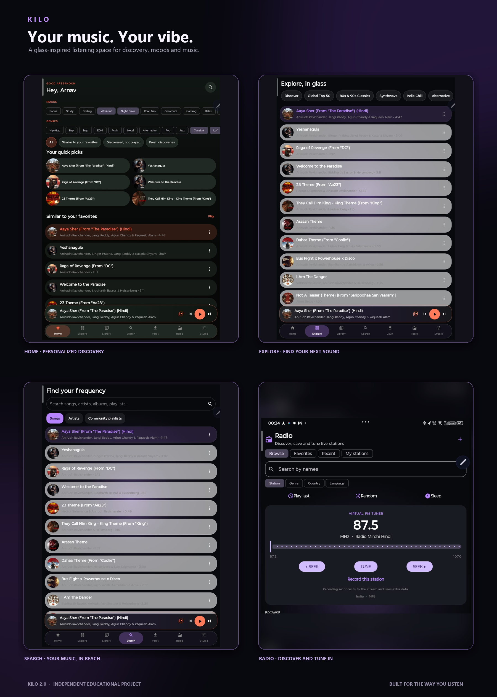

# KILO

### Your music. Your vibe.

**An Android music player project exploring modern playback, discovery and personalization.**

## About

Kilo is an **educational project** built to explore how a feature-rich Android music player can be designed and developed. It brings together a glass-inspired interface, music browsing and search, mood and genre personalization, playback controls, an offline vault, radio and Android Auto support.

The project is intended for learning, experimentation and community feedback. It is independent and is not affiliated with or endorsed by Yuma, BitChord, YouTube, YouTube Music or any other music service. The interface takes inspiration from contemporary music-player design while Kilo develops its own visual identity and feature set.

## What you can explore

- **Personalized home** — Mood and genre choices, quick picks and discovery groupings.
- **Music discovery** — Browse and search tracks, artists and community playlists.
- **Listening controls** — A persistent player, queue controls, playback options and equalizer integration.
- **Offline vault** — Manage available downloaded music in one place.
- **Radio** — Browse stations, save favorites and tune in to streams.
- **Android Auto** — Explore a car-friendly listening experience.
- **Glass-inspired appearance** — Dark surfaces, soft color accents and artwork-led visuals.

Feature availability depends on the build and the configured sources. Kilo does not include music rights; users are responsible for ensuring they have permission to access or play any content and streams they configure.

## Get Kilo

Download the current release from [GitHub Releases](https://github.com/KineticFusion/Kilo-An-Android-Auto-Music-Player/releases/latest). Check each release page for its APK and version-specific notes.

## Learning and contributing

Kilo is shared as a way to learn from and experiment with an Android music-player project. You can browse the Kotlin and Gradle code, try the app, report reproducible bugs or propose improvements through GitHub issues and pull requests.

When reporting a problem, include the Kilo version, Android version and device model, plus steps to reproduce it. Avoid posting private account details, access tokens or copyrighted media.

## Project notes

- This is an independent educational project; names and marks belonging to other services remain the property of their respective owners.
- Kilo is not a music hosting service and does not grant rights to third-party content.
- Review the permissions requested by the app and the terms of any source you choose to use.

## License

Kilo is released under the [GNU General Public License v3.0](LICENSE).

**KILO — Your music, your vibe.**

