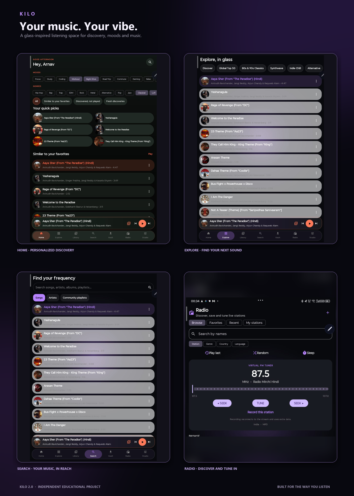

<div align="center">

# KILO

### Your music. Your vibe.

**A modern Android music player with native crossfade, Spotify integration, and YouTube Music hybrid playback.**

[](https://github.com/KineticFusion/Kilo-An-Android-Auto-Music-Player/releases/latest)
[](LICENSE)
[](https://developer.android.com/)
[-green?style=for-the-badge)](https://developer.android.com/about/versions)
[-blue?style=for-the-badge)](https://developer.android.com/about/versions)
[](https://kotlinlang.org/)
[](https://developer.android.com/jetpack/compose)
[-ff6b35?style=for-the-badge)](https://developer.android.com/ndk)
[](https://github.com/KineticFusion/Kilo-An-Android-Auto-Music-Player)



</div>

---

## ✨ Features

### 🎵 **Native Crossfade Engine** (BitChord-Style)
True gapless transitions with a **C++/NDK native mixer** using Oboe 1.9.3.
- **Equal-power curves** — `cos/sin` for constant perceived loudness
- **Configurable 0–12s** — Off, 1s, 2s, 3s, 5s, 8s, 10s, 12s
- **Automix EQ sweep** — HPF 20Hz→350Hz on outgoing + LPF on incoming
- **Soft clipping** — `tanh()` prevents digital clipping at blend peaks
- **Lock-free ring buffers** — SPSC with atomic indices, zero allocations in hot path
- **16KB ELF aligned** — Ready for Android 15+ (`-Wl,-z,max-page-size=16384`)

### 🎧 **Hybrid Source Modes**
Choose your music source globally from **Settings → Music Discovery**:
| Mode | Behavior |
|------|----------|
| **Both (Hybrid)** | Spotify metadata + YouTube Music audio (default) |
| **Spotify Only** | Spotify catalog only — requires Premium |
| **YouTube Music Only** | YouTube Music catalog only |

Persisted in `SharedPreferences`, filtered at `HybridSourceRegistry` level.

### 🔍 **Native Spotify Browsing** (Yuma-Style)
Full Spotify catalog browsing **inside the app** — no external browser needed.
- **Home**: New Releases, Featured Playlists, Browse Categories (Genres & Moods)
- **Library**: Your Spotify Playlists with track counts, covers, expand-to-view
- **Search**: Unified search across Spotify + YouTube Music
- **Playback**: `sp_dc` cookie auth with auto token refresh

### 🌍 **Lyrics Translation**
Translate lyrics from **any language → English** via MyMemory API (free, no key).
- Toggle in **Settings → Lyrics & Karaoke**
- Automatic language detection
- Cached locally for offline viewing

### 🎨 **Modern UI/UX**
- **Glass-inspired Material3** — Dark surfaces, soft accents, artwork-led visuals
- **Animated category grid** — `LazyVerticalGrid` with smooth transitions
- **Spotify green accent** theming for native sections
- **Expand/collapse playlists** with animated track lists
- **Persistent mini-player** with queue, equalizer, sleep timer

### 🚗 **Android Auto**
Full Media3 session integration — browse, play, control from your car display.

---

## 📱 Screenshots

<div align="center">

| Home | Explore | Search | Library |
|:---:|:---:|:---:|:---:|
|  |  |  |  |

| Now Playing | Settings | Android Auto | Equalizer |
|:---:|:---:|:---:|:---:|
|  |  |  |  |

</div>

---

## 🏗 Architecture

```
┌─────────────────────────────────────────────────────────────┐
│                        KILO App                              │
├─────────────────────────────────────────────────────────────┤
│  UI Layer (Compose Material3)                               │
│  ├── Home / Explore / Search / Library / Settings           │
│  └── ViewModels + StateFlow                                 │
├─────────────────────────────────────────────────────────────┤
│  Domain Layer                                               │
│  ├── Spotify (auth/, net/, models/, parser/, mapping/,      │
│  │          matching/) — CQRS-lite, GraphQL persisted       │
│  ├── HybridSourceRegistry — Provider registry + source mode │
│  └── CrossfadeOrchestrator — Transition scheduler           │
├─────────────────────────────────────────────────────────────┤
│  Playback Layer (Media3 1.6.1)                              │
│  ├── NativeCrossfadeController — Dual ExoPlayer + NDK mixer │
│  ├── BackgroundPlaybackCoordinator — Command ledger         │
│  └── MediaSessionCoordinator — Android Auto / Notifications │
├─────────────────────────────────────────────────────────────┤
│  Native Layer (C++20, NDK r27)                              │
│  ├── native_mixer.cpp — Oboe audio output + crossfade       │
│  ├── ring_buffer.h — SPSC lock-free ring buffer             │
│  ├── biquad_filter.h — HPF/LPF for Automix EQ               │
│  └── jni_bridge.cpp — JNI bindings                          │
└─────────────────────────────────────────────────────────────┘
```

---

## 🛠 Tech Stack

| Layer | Technology |
|-------|------------|
| **Language** | Kotlin 2.2.10, C++20 |
| **UI** | Jetpack Compose Material3, StateFlow |
| **Architecture** | MVVM + Clean Architecture, CQRS-lite |
| **Audio** | Media3 ExoPlayer 1.6.1, Oboe 1.9.3 (NDK) |
| **Network** | Ktor + kotlinx.serialization |
| **Auth** | Tink AES-256-GCM + Android Keystore |
| **GraphQL** | Persisted queries with auto hash invalidation |
| **DI** | Manual (no Dagger/Hilt) |
| **Build** | Gradle Kotlin DSL, AGP 9.4.1, NDK r27 |

---

## 🚀 Getting Started

### Prerequisites
- Android Studio **Ladybug | 2024.2.1+**
- JDK **21** (for AGP 9.4+)
- NDK **r27** (27.0.12077973)
- Android SDK **37** (Android 15)

### Build
```bash
# Clone
git clone https://github.com/KineticFusion/Kilo-An-Android-Auto-Music-Player.git
cd Kilo-An-Android-Auto-Music-Player

# Build debug APK
./gradlew assembleDebug

# Build release APK (requires signing config)
./gradlew assembleRelease
```

### Configuration
1. **Spotify**: Add `sp_dc` cookie via in-app login (WebView)
2. **YouTube Music**: No config needed (public endpoints)
3. **Source Mode**: Settings → Music Discovery → choose Hybrid/Spotify/YT Music

---

## 📦 Releases

Download the latest APK from [GitHub Releases](https://github.com/KineticFusion/Kilo-An-Android-Auto-Music-Player/releases/latest).

| Version | Highlights | APK Size |
|---------|------------|----------|
| **v3.5.0** | Native crossfade, Spotify browsing, source modes, 16KB aligned | ~34 MB |
| v3.4.x | Hybrid playback, lyrics, equalizer, Android Auto | ~28 MB |

---

## 🗺 Roadmap

See [ROADMAP.md](ROADMAP.md) for planned features.

### v3.6 (Next)
- [ ] **Qobuz/FLAC via QBDX** — Lossless streaming support
- [ ] **Daily Mixes / Discovery Weekly** — Auto-generated from history
- [ ] **Cross-source Smart Queue** — Manual match override
- [ ] **Equalizer DSP in Native Mixer** — Parametric EQ, limiter, compressor

### v3.7
- [ ] **Local file scanning** — MediaStore integration
- [ ] **Last.fm scrobbling** — Now playing + history sync
- [ ] **Chromecast support** — Cast to speakers/TV
- [ ] **Widget** — Glance-based home screen controls

### v4.0
- [ ] **Multi-account Spotify** — Switch accounts in-app
- [ ] **Playlist collaboration** — Shared queue editing
- [ ] **AI-powered recommendations** — Mood/activity based
- [ ] **Wear OS companion** — Wrist controls

---

## 🤝 Contributing

Kilo is an **educational project** shared for learning and experimentation.

1. Fork the repo
2. Create a feature branch (`git checkout -b feature/amazing-feature`)
3. Commit your changes (`git commit -m 'Add amazing feature'`)
4. Push to the branch (`git push origin feature/amazing-feature`)
5. Open a Pull Request

### Reporting Issues
Include:
- Kilo version
- Android version + device model
- Steps to reproduce
- Logcat (if crash)

**Do not post** private account details, access tokens, or copyrighted media.

---

## ⚖️ License

Kilo is released under the [GNU General Public License v3.0](LICENSE).

> **Disclaimer**: This is an independent educational project. Names and marks belonging to Spotify, YouTube, YouTube Music, Qobuz, and other services remain the property of their respective owners. Kilo is not a music hosting service and does not grant rights to third-party content. Users are responsible for ensuring they have permission to access or play any content they configure.

---

## 🙏 Acknowledgments

- **BitChord** — Crossfade algorithm reference (equal-power curve, Automix EQ)
- **Yuma Player** — Native Spotify browsing UX inspiration
- **Oboe Team** — Low-latency audio library with 16KB page support
- **MyMemory API** — Free translation service for lyrics
- **Media3 Team** — ExoPlayer & MediaSession APIs
- **Kotlin & Compose Teams** — Modern Android development

---

<div align="center">

**KILO — Your music, your vibe.**

[⬆ Back to top](#kilo)

</div>